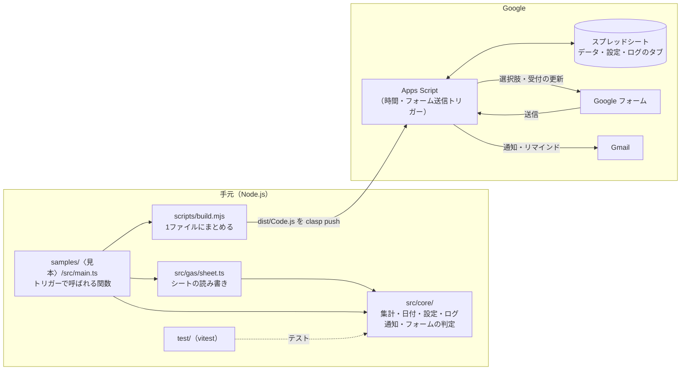

# GAS 業務自動化サンプル集

Google スプレッドシート × Google Apps Script（GAS）でよくある業務自動化を、5つの小さな見本にしたものです（01・03 は完成、ほかは作成中）。
紹介ページ（GAS の Web アプリ）から、それぞれの見本のシートと動きを見られます。

| # | 見本 | こんな仕事の人に（例） | リンク |
|---|---|---|---|
| 01 | 通知・リマインド（条件を満たしたら Gmail で知らせる・前日に自動リマインド） | 予約制のお店の前日連絡 ／ ネットショップの注文通知 ／ 面接・面談のリマインド | （公開後に記載） |
| 02 | 定期的に取ってきて記録（毎朝・毎時にデータを取得してシートへ） | 価格・相場の記録 ／ 公開情報の定点チェック ／ 日次の数値の自動記録 | 作成中 |
| 03 | フォームで受け付けて管理（申込 → 一覧・締切・定員） | 教室・イベントの申込 ／ 問い合わせ受付 ／ 予約の受付 | （公開後に記載） |
| 04 | データの整理・分割（貼り付けたデータを決まった形に） | 注文・顧客 CSV の整理 ／ 担当者別にシートを分ける ／ 定期バックアップ | 作成中 |
| 05 | 集計・ダッシュボード（日・週・月・年で切り替え、前期比・目標達成率） | 売上・件数の月次集計 ／ 複数の売り場・担当のまとめ | 作成中 |

- データはすべて架空のものです
- 集計などのロジックは Google の機能から切り離し、手元で自動テストしています（`npm test`）

## 構成

```
src/core/        共通ロジック（Google 非依存・テストあり）: 集計・日付・設定タブ・ログ
src/gas/         GAS 側の共通部品（シートの読み書き）
scripts/build.mjs 見本ごとに samples/<見本>/dist/Code.js へまとめる
src/showcase/    紹介ページ（GAS Web アプリのフロント・作成中）
samples/01〜05/  各見本（GAS の薄い層・見本シートの作り方）
test/            自動テスト
```

### 構成図

ロジック（`src/core/`）は Google の API に依存しない純粋な TypeScript なので、手元で自動テストできます。Google のサービスに触るのは薄い層（`src/gas/` と各見本の `main.ts`）だけです。



| 見本 | 使う Google のサービス | 状態 |
|---|---|---|
| 01 通知・リマインド | スプレッドシート・Gmail・時間トリガー | 完成 |
| 03 フォーム受付 | フォーム・スプレッドシート・Gmail・送信／時間トリガー | 完成 |
| 02・04・05 | — | 作成中 |

## 開発

```
npm install
npm test        # ロジックのテスト
npm run typecheck
npm run build     # samples/<見本>/dist/ に GAS 用の1ファイル
```

GAS への反映は clasp（`clasp login` → `clasp push`）。見本用の Google アカウントを使う。
